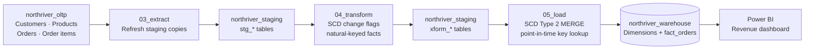

# NorthRiver Data Warehouse — Project Report

## Executive summary

BrewFlow needs a reliable way to turn order, customer, product, and sales-channel activity into trusted revenue reporting. The warehouse preserves the detail needed to trace revenue to the customer and product attributes that applied when an order was placed, while a scheduled pipeline keeps reporting current without routine manual intervention.

## Architecture

The solution follows a three-layer ELT design in Databricks:

| Layer | Schema | Role |
|---|---|---|
| Transactional source | `northriver_oltp` | Customers, products, orders, and order lines |
| Staging | `northriver_staging` | Refreshed source copies and transformation outputs |
| Analytics warehouse | `northriver_warehouse` | `fact_orders` and the four dimensions `dim_date`, `dim_channel`, `dim_customer`, and `dim_product` |

### Nightly job flow

The scheduled Lakeflow job `northriver_nightly_pipeline` runs its tasks in dependency order. The initial table setup and sample data changes are one-time preparation; the recurring job begins at extraction.

The pipeline runs `03_extract` → `04_transform` → `05_load`. Power BI connects to the Databricks SQL warehouse endpoint and reports revenue by product category, customer region, and sales channel over time.

## Data model and loading decisions

- **Fact grain:** one row per order line item, identified by `order_item_id`. Revenue is quantity multiplied by unit price.
- **Dimensions:** date, channel, customer, and product provide the reporting context.
- **History:** customer region/segment and product category use SCD Type 2. Changes close the prior row and insert a current version.
- **Load order:** extract source tables to staging; classify dimension changes and prepare fact rows; load dimensions before facts so surrogate keys can be resolved.
- **Late-arriving facts:** customer and product surrogate keys are selected using the order date between each dimension version’s `effective_from` and `effective_to`. Channel uses a direct lookup because it is a non-historical dimension.
- **Idempotency:** the fact load inserts only previously unseen `order_item_id` values, avoiding a full-table truncate/reload.

## Pipeline SQL

The repository includes the six SQL scripts used for source setup, simulation, and pipeline execution:

| Query | Repository file | Purpose |
|---|---|---|
| `01-Create OLTP Tables` | [`01-Create-OLTP-Tables.sql`](../sql/01-Create-OLTP-Tables.sql) | Creates and seeds the NorthRiver transactional source tables |
| `OLTP Data Changes` | [`OLTP-Data-Changes.sql`](../sql/OLTP-Data-Changes.sql) | Simulates a new customer, customer-region change, new orders, and a late-arriving order |
| `02-Create Warehouse Tables` | [`02-Create-Warehouse-Tables.sql`](../sql/02-Create-Warehouse-Tables.sql) | Creates the warehouse star schema |
| `03_extract` | [`03-extract.sql`](../sql/03-extract.sql) | Refreshes staging copies from the OLTP source |
| `04_transform` | [`04-transform.sql`](../sql/04-transform.sql) | Produces change-flagged dimensions and natural-keyed order-line rows |
| `05_load` | [`05-load.sql`](../sql/05-load.sql) | Applies SCD Type 2 merges and resolves surrogate keys while loading facts |

## Power BI report

The report canvas contains three visuals:

1. **Revenue by product category** — clustered bar chart; category on the axis and summed revenue as values.
2. **Revenue by customer region** — pie chart; region as legend and summed revenue as values. Filter `dim_customer[is_current] = TRUE` to present current-region totals; leave historical rows available when analyzing historical assignments.
3. **Revenue by sales channel over time** — line chart; month on the X-axis, summed revenue on the Y-axis, and channel as legend.

Because each fact row references the correct customer dimension surrogate key, historical facts retain the region version that applied at order time.

## Validation evidence

The Sprint 4 walkthrough reported the following checks:

- Initial warehouse load: 32 fact rows.
- Simulated incremental load: three new order items added; existing rows remained in place, bringing the fact count to 35.
- Customer history: the changed customer has the prior and current Type 2 versions; the new customer is added. The walkthrough expected 20 customer dimension rows after the simulation.
- Late-arriving order: point-in-time joins assign the customer version that was valid on the order date (the historical North region), rather than the current version.
- Pipeline outputs include row-count summaries in extraction, change-type counts in transformation, and dimension/fact verification queries after loading.

## Limitations and next improvement

The source is a training dataset and the pipeline runs under Free Edition constraints. A useful next step is to connect a broader production source (for example, PostgreSQL through a JDBC view), add automated validation for key uniqueness, referential integrity, and revenue reconciliation, and configure production retry policies and failure alerts.

## Sprint progression

| Sprint | Outcome |
|---|---|
| 1 | Source staging tables |
| 2 | Star schema and manual loading |
| 3 | SCD Type 2 history and validation, with manual pipeline gaps |
| 4 | Scheduled Databricks orchestration, incremental/idempotent loading, late-arrival handling, and Power BI reporting |
